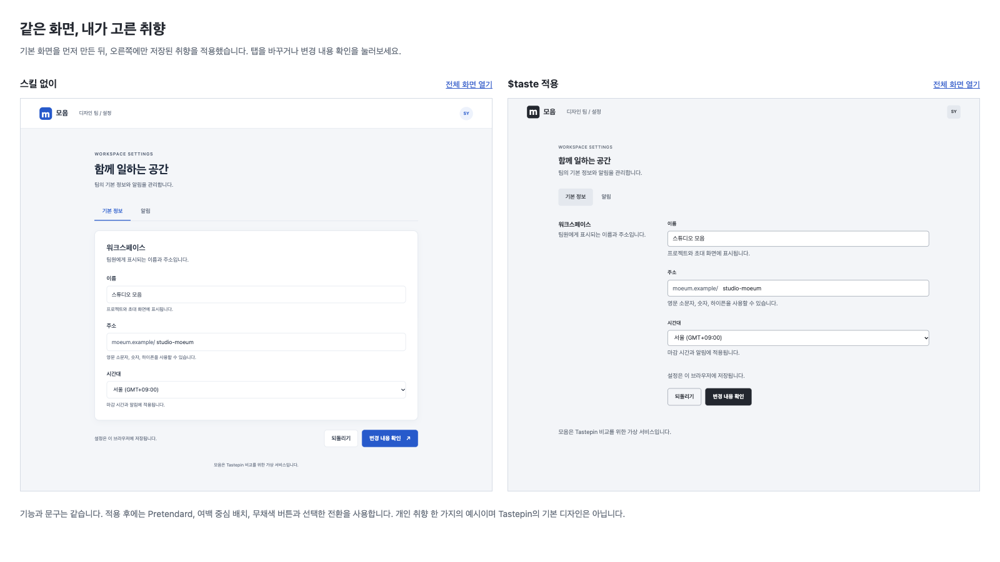
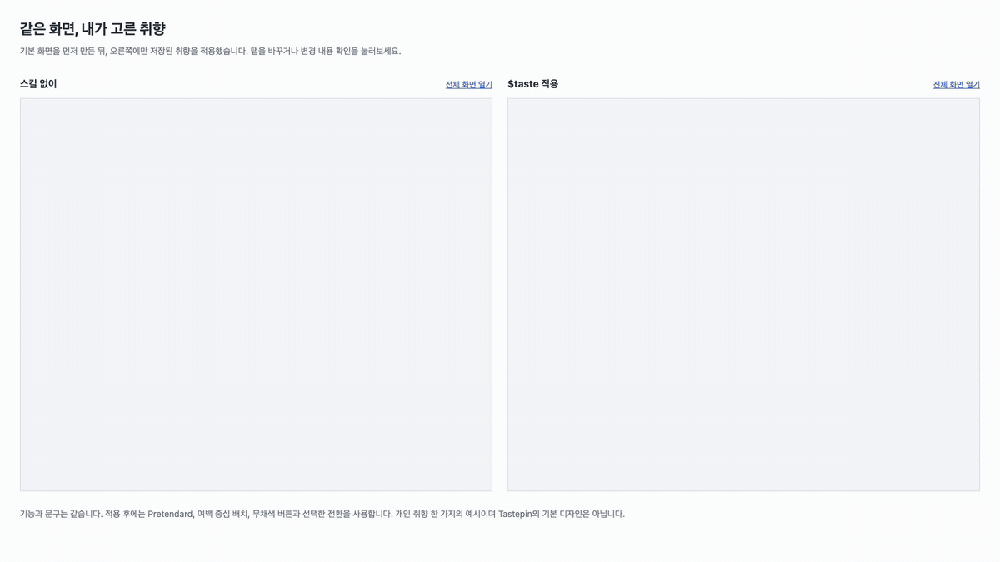

# 취향 적용 전후

같은 워크스페이스 설정 화면에 개인 취향을 적용한 예시입니다.

1. `before/`: `$taste`로 취향을 읽기 전에 만든 화면입니다.
2. `after/`: 기본 화면을 복사한 뒤, `$taste`로 읽은 선택값을 적용했습니다.

이 예시의 디자인은 한 사용자의 선택 결과이며, Tastepin의 기본값은 아닙니다. 기존 대화에서 일부 취향을 알고 있던 같은 세션에서 만들었으므로, 취향을 전혀 모르는 별도 세션과의 실험은 아닙니다.

## 열기

Tastepin 저장소 루트에서 실행합니다. 별도 패키지 설치는 필요하지 않습니다.

```sh
python3 -B -m http.server 5187 --bind 127.0.0.1 --directory examples/settings
```

- 비교: <http://127.0.0.1:5187/>
- 스킬 없이: <http://127.0.0.1:5187/before/>
- `$taste` 적용: <http://127.0.0.1:5187/after/>

이름과 주소를 수정하거나 알림 탭을 열어보세요. 변경 내용 확인을 누르면 다이얼로그가 열립니다. 저장한 값은 각 화면의 브라우저 저장 공간에 따로 남으며, 서버로 전송하지 않습니다. 적용 후 화면은 jsDelivr에서 Pretendard 글꼴을 불러옵니다.

## 달라진 부분

- 시스템 서체에서 Pretendard로 변경했습니다. 본문은 15px, 제목은 21px와 굵기 650을 사용합니다.
- 카드 대신 여백으로 설명과 입력란을 구분합니다.
- 주 버튼을 무채색으로 바꾸고 모서리를 6px로 맞췄습니다.
- 선택한 탭 뒤의 면이 200ms 동안 이동합니다. 패널은 방향에 따라 12px 이동하며 180ms 동안 교체됩니다.
- 다이얼로그는 0.96배에서 커지고, 같은 경로로 닫힙니다. 열고 닫는 시간은 각각 300ms입니다.
- 저장 알림은 오른쪽 아래에서 300ms 동안 나타나고 사라집니다. 휴대폰에서는 아래 가운데에 표시합니다.

기능과 문구는 유지했습니다. 문구를 줄이는 취향 규칙은 이번 비교에 적용하지 않았습니다. 컴포넌트별로 선택한 곡선과 시간을 CSS와 브라우저 애니메이션 API로 구현했으며, 별도 Motion 의존성은 추가하지 않았습니다.

## 비교 자료





- 각 화면은 1200 × 1000px이며, 비교 페이지 안에서 같은 비율로 축소합니다.
- GIF는 두 화면을 동시에 조작한 실제 브라우저 녹화입니다. 재생 속도를 바꾸지 않았습니다.
- 저장과 입력 처리는 공통 `app.js`를 사용합니다. 적용 후에만 `after/style.css`와 `after/motion.js`를 추가합니다.
- 기본 화면을 만든 뒤 취향을 읽었습니다. 이후 발견한 주소 입력 검사 오류는 양쪽 HTML에 동일하게 수정했습니다. `baseline.sha256`은 이 공통 수정까지 반영한 기본 화면과 공통 동작의 파일 해시입니다.

## 확인한 범위

- 양쪽 화면의 탭, 저장, 새로고침 후 복원, 되돌리기, 잘못된 주소 입력.
- 방향키로 탭 이동, Escape로 다이얼로그 닫기, 닫힌 뒤 버튼으로 초점 복귀.
- 라이트, 다크, 휴대폰 화면과 모션 감소 설정.
- 적용 후 화면의 취향 검사: 실패 0, 주의 0, 통과 20, 미판정 4.

자동 검사가 판정하지 못한 모션 길이와 전환은 실제 화면과 녹화로 확인합니다. 개인 원장의 대화 인용이나 세션 식별자는 예제에 포함하지 않았습니다.
